*This project has been created as part of the 42 curriculum by akoaik, msafa.*

<p align="center">
  
</p>

<p align="center">
  <b>One process &nbsp;·&nbsp; one <code>poll()</code> &nbsp;·&nbsp; no blocking call on any socket</b><br>
  <sub>An NGINX-inspired web server, written from scratch in C++98 at 42 Beirut.</sub>
</p>

<div align="center">

| Route | What you get |
|:--|:--|
| [`GET /description`](#description) | what webserv is, and everything it can do |
| [`GET /instructions`](#instructions) | build it, run it, write your own config |
| [`GET /how-it-works`](#how-it-works) | one request through the server, step by step, with diagrams |
| [`GET /evaluation`](#evaluation-cheat-sheet) | copy-paste tests for every feature, with the expected answer |
| [`GET /resources`](#resources) | RFCs, docs, our notes, and how we used AI |

</div>

## Description

**webserv** is an HTTP/1.1 server written from scratch in C++98, inspired by NGINX.
It reads an NGINX-like configuration file and opens one or more ports.
Then it serves static websites, saves uploaded files, deletes files and runs CGI scripts.
Browsers, `curl`, `telnet`, `nc` and `siege` can all talk to it.

The goal is to understand what happens inside a web server: sockets, non-blocking I/O, the HTTP protocol and CGI.

The whole server is **one process with one loop**.
Every file descriptor (listen sockets, clients, CGI pipes) is non-blocking and waits in the same `poll()`.
The server never reads or writes one of them before `poll()` says that it is ready,
so one slow client can never block the others.

### What it can do

| | Feature | How |
|:-:|:--|:--|
| 🔁 | **One event loop** | a single `poll()` for listen sockets, clients and CGI pipes. Every fd is `O_NONBLOCK` |
| 📄 | **Static websites** | files with the right `Content-Type`, `index` files, directory listing with `autoindex` |
| 📤 | **Uploads** | raw body (`POST /upload/name.txt`) or `multipart/form-data`, several files in one request |
| 🗑️ | **Delete** | `DELETE` removes a file and answers `204 No Content` |
| 🧭 | **Routing** | `location` blocks with longest-prefix match, allowed methods per route, `return 301` redirects |
| 🐍 | **CGI** | chosen by file extension (`.py`, `.php`), runs in the folder of the script, killed after 10 s |
| 🔗 | **HTTP/1.1** | keep-alive connections, chunked request bodies, `Host` header required |
| 🛡️ | **Safety** | `client_max_body_size`, `%XX` decoding, `..` can never leave the root, idle clients closed after 75 s |
| 🌐 | **Many servers** | several `server` blocks, each one with its own `host:port`, body limit and error pages |
| 🚧 | **Error pages** | a custom page per status code with `error_page`, or a built-in page |

### By the numbers

| **1** | **0** | **0** | **25** | **2 222** | **3** |
|:-:|:-:|:-:|:-:|:-:|:-:|
| `poll()` for everything | threads | external libraries | `.cpp` files | lines of C++98¹ | servers in `multipleServers.conf` |

<sub>¹ Without blank lines and without the 42 headers.</sub>

### A real exchange

These are the exact bytes of an upload, sent by hand with `nc`, and the real answer of the server:

```console
$ printf 'POST /upload/notes.txt HTTP/1.1\r\nHost: localhost:8080\r\nContent-Type: text/plain\r\nContent-Length: 11\r\nConnection: close\r\n\r\nhello world' | nc localhost 8080
HTTP/1.1 201 Created
Connection: close
Content-Type: text/plain
Location: /upload/notes.txt
Content-Length: 7

Created
```

The same exchange, line by line:

<p align="center">
  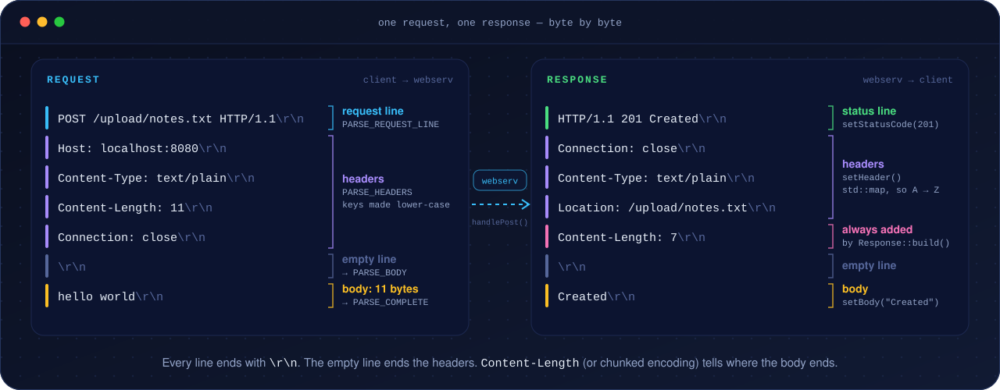
</p>

## Instructions

### Requirements

- Linux (tested on Ubuntu), a C++ compiler with C++98 support (`c++`), and `make`.
- `python3` in `/usr/bin/python3` for the Python CGI scripts.
- `php-cgi` in `/usr/bin/php-cgi` for the PHP example (only in `multipleServers.conf`).
- To test: `curl`, `nc`, `telnet`, `siege`, and `strace` for `trace.sh`.

### Build

| Command | What it does |
|:--|:--|
| `make` | builds `./webserv` with `-Wall -Wextra -Werror -std=c++98` |
| `make clean` | removes the object files |
| `make fclean` | removes the object files and the binary |
| `make re` | rebuilds everything |
| `make debug` | rebuilds, then opens the server in `gdb -tui` |

### Run

```bash
./webserv                        # no argument: uses default.conf
./webserv default.conf           # one server on port 8080
./webserv multipleServers.conf   # three servers on ports 8080, 8081 and 9000
```

> [!IMPORTANT]
> Start the server from the root of the repository: the paths in the config files (`root`, `upload_store`, `error_page`) are relative to it.
> Both configs use port 8080, so run only one at a time.

Stop the server with <kbd>Ctrl</kbd> + <kbd>C</kbd>.
The loop ends, every client, CGI process and socket is cleaned up, and the server prints `Webserver stopped`.

What `multipleServers.conf` starts:

| Server | Listens on | Body limit | Routes |
|:-:|:--|:-:|:--|
| 1 | `0.0.0.0:8080` | 100M | `/` · `/files` · `/upload` · `/old` → `/new` · `/cgi-bin` (Python) · `/php` (PHP) |
| 2 | `127.0.0.1:8081` | 1K | `/` · `/secret` → `/` · `/data` (upload and delete) |
| 3 | `127.0.0.1:9000` | 512K | `/` · `/api` (Python, JSON) · `/static` · `/redirect-me` → `/api` · `/upload` |

### Configuration

The syntax is close to NGINX. This is a shorter `default.conf`, with comments:

```nginx
http {
    server {
        listen               0.0.0.0:8080;     # host:port of this server
        client_max_body_size 10M;              # in bytes, or with K / M (default: 1M)
        error_page 404 /errors/404.html;       # one line per status code

        location / {                           # the longest matching prefix wins
            methods   GET;                     # allowed methods: GET POST DELETE
            root      www/default/html;        # where the files are
            index     index.html;              # file to serve for a folder
            autoindex off;                     # list the folder if there is no index
        }

        location /upload {
            methods      GET POST DELETE;
            root         www/default/uploads;
            upload_store www/default/uploads;  # where POST saves the files
            autoindex    on;
        }

        location /old {
            methods GET;
            return 301 /;                      # redirect, checked before the methods
        }

        location /cgi-bin {
            methods  GET POST;
            root     www/default/cgi-bin;
            cgi_pass .py /usr/bin/python3;     # extension, then the interpreter (optional)
        }
    }
}
```

| Directive | Block | Example | Notes |
|:--|:-:|:--|:--|
| `listen` | server | `listen 127.0.0.1:8081;` | required. Port from 1 to 65535 |
| `client_max_body_size` | server | `client_max_body_size 1K;` | default `1M`. A bigger body gets `413` |
| `error_page` | server | `error_page 404 /errors/404.html;` | if the file is missing, a built-in page is used |
| `location` | server | `location /files { … }` | longest prefix wins. The prefix is replaced by `root` |
| `methods` | location | `methods GET POST;` | `GET`, `POST`, `DELETE`. Any other method gets `405` |
| `root` | location | `root www/default/html;` | required to serve files (else `500`) |
| `index` | location | `index index.html;` | served when the URL is a folder |
| `autoindex` | location | `autoindex on;` | lists the folder when there is no index. Default `off` |
| `upload_store` | location | `upload_store www/default/uploads;` | folder for uploads. If it is not set, `root` is used |
| `return` | location | `return 301 /new;` | redirect |
| `cgi_pass` | location | `cgi_pass .php;` | extension, then an optional interpreter. Defaults: `.py` → `/usr/bin/python3`, `.php` → `/usr/bin/php-cgi` |

> [!TIP]
> - The file must start with `http {`. Comments start with `#`.
> - A `location` without `methods` accepts no method. Only its `return` still works.
> - The prefix of the location is replaced by `root`. With `location /files { root www/default/files; }`,
>   the URL `/files/hello.txt` is the file `www/default/files/hello.txt`.

### Project layout

```text
.
├── main.cpp                entry point: load the config, open the servers, run the loop
├── Makefile
├── default.conf            1 server  (port 8080)
├── multipleServers.conf    3 servers (ports 8080, 8081, 9000)
├── trace.sh                live view of every accept / recv / send / close (uses strace)
├── includes/
│   ├── classes/            Client, Server, Request, Response, parse, cgi_process
│   └── functions/          headers of the free functions (event loop, I/O, helpers)
├── src/
│   ├── parsing/            config file → tokens → server and location structs
│   ├── server/             sockets, accept(), the poll() loop, client I/O
│   ├── http/               request parser, response builder, routing
│   │   └── methods/        GET, POST (+ multipart), DELETE, autoindex, MIME types
│   └── CGI/                fork() + execve(), non-blocking pipes, CGI output parsing
├── errors/                 default error pages (400 … 504)
├── www/                    test websites of the two configs
└── assets/                 images of this README
```

## How it works

Follow one request from the network to the answer.
Each step names the files where it happens.

Colors in the diagrams: **blue** is the loop, **violet** is socket I/O, **yellow** is a decision,
**green** is a success, **red** is an error, **pink** is CGI.

### 0. The big picture

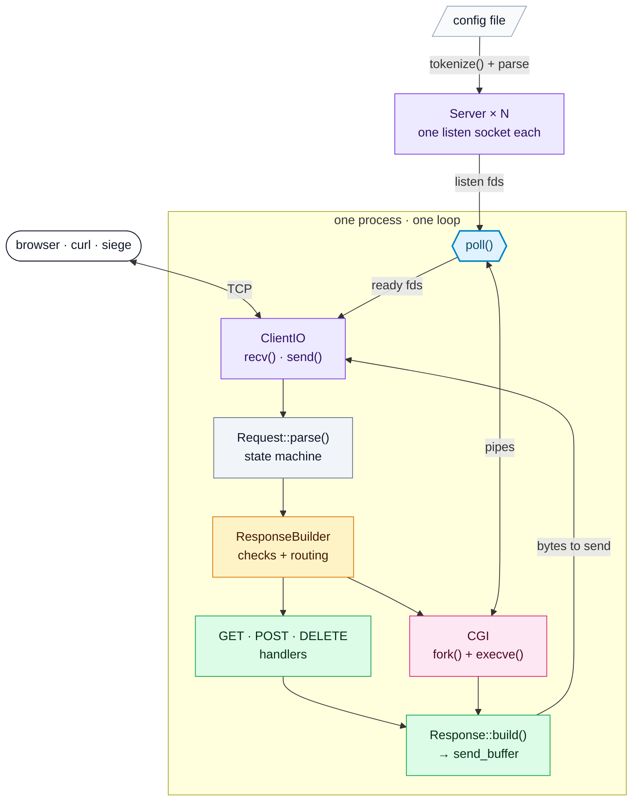

### 1. Boot: from a config file to listening sockets

<sub>`main.cpp` · `src/parsing/` · `src/server/Server.cpp` · `src/server/socketUtils.cpp`</sub>

1. `main()` ignores `SIGPIPE`, so a client that leaves cannot kill the server. It catches `SIGINT`, so <kbd>Ctrl</kbd> + <kbd>C</kbd> ends the loop cleanly.
2. `tokenize()` cuts the config file into words and the symbols `{` `}` `;`. Comments are dropped.
3. `parse::parseTokens()` reads `http { server { location { } } }` into `serConfig` and `locConfig` structs. Any mistake stops the server with a clear message.
4. Each `server` block becomes a `Server`, which opens its listen socket.

```text
location /files { autoindex on; }
         │  tokenize()
         ▼
[location] [/files] [{] [autoindex] [on] [;] [}]
```

```text
socket() ─▶ setsockopt(SO_REUSEADDR) ─▶ getaddrinfo() + bind() ─▶ listen(fd, 4096) ─▶ fcntl(O_NONBLOCK)
```

<details>
<summary><b>The data model</b>: who owns what</summary>

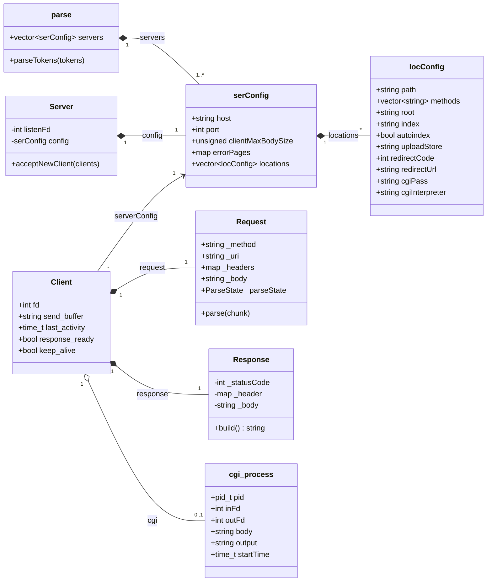

</details>

### 2. The event loop

<sub>`src/server/EventLoop.cpp`</sub>

Everything happens in this loop. One turn:

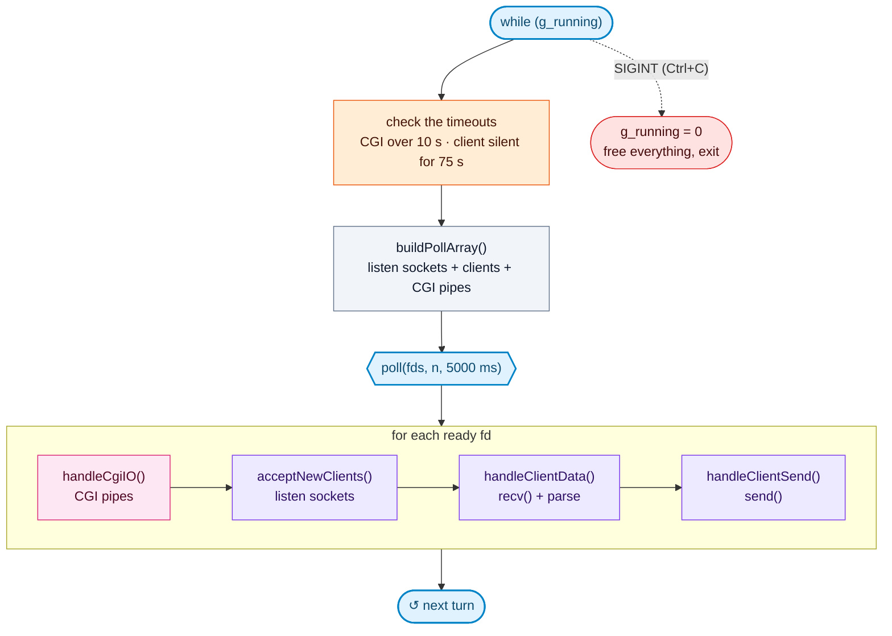

| Step | Function | What it does |
|:-:|:--|:--|
| 1 | `checkCgiTimeouts()` | a CGI that runs for more than 10 s is killed, the client gets `504` |
| 2 | `checkClientTimeouts()` | a client that sent nothing for more than 75 s is closed |
| 3 | `buildPollArray()` | lists every fd to watch, with the events of the table below |
| 4 | `poll()` | sleeps until an fd is ready, or 5 s pass |
| 5 | `handleCgiIO()` | writes the body to the CGI stdin, reads the CGI stdout |
| 6 | `acceptNewClients()` | `accept()` on the ready listen sockets, a new `Client` per connection |
| 7 | `handleClientData()` | `recv()` up to 4095 bytes, `Request::parse()`, then build the response if it is complete |
| 8 | `handleClientSend()` | `send()` what is left in `send_buffer`, then keep-alive or close |

The poll array is built again at every turn, so file descriptors can come and go freely:

| File descriptor | Events | Ready means |
|:--|:--|:--|
| listen socket (one per server) | `POLLIN` | a new client waits in `accept()` |
| client socket | `POLLIN`, and `POLLOUT` when a response is ready | bytes to read / room to send |
| CGI stdin (pipe) | `POLLOUT` | the script can take more of the body |
| CGI stdout (pipe) | `POLLIN` | the script printed something (or finished) |

The 5 second timeout of `poll()` wakes the loop up even when nobody talks, so the timeouts are always checked.

### 3. Reading the request

<sub>`src/server/ClientIO.cpp` · `src/http/Request.cpp` · `src/http/Request_helper.cpp`</sub>

At each turn, `recv()` reads at most 4095 bytes from a ready client.
The bytes go to the end of a buffer, and the parser continues from the state where it stopped.
A request can arrive in one piece or one byte at a time: the result is the same.

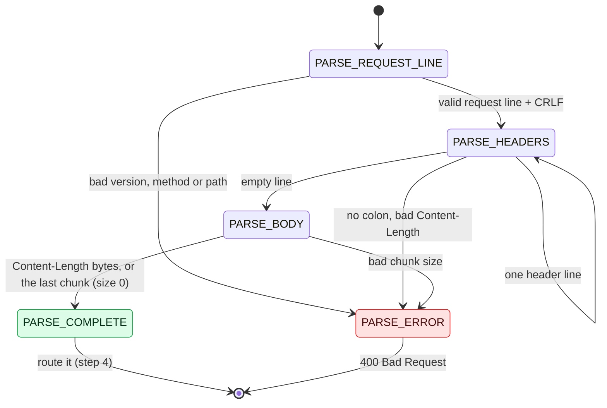

Before the headers are read, the path goes through two filters:

- `urlDecode()` turns `%2e` into `.`. A bad `%XX` or a `%00` is a `400`.
- `normalizeUri()` removes the `.` and `..` segments. A `..` that goes above `/` is a `400`.

```console
$ curl -i --path-as-is http://localhost:8080/../../etc/passwd
HTTP/1.1 400 Bad Request

$ curl -i http://localhost:8080/files/%2e%2e/%2e%2e/%2e%2e/etc/passwd
HTTP/1.1 400 Bad Request
```

### 4. Checks and routing

<sub>`src/http/ResponseBuilder.cpp` · `src/http/methods/GET.cpp` (`findLocation()`)</sub>

After each `recv()`, the server decides what to do. The checks run in this order:

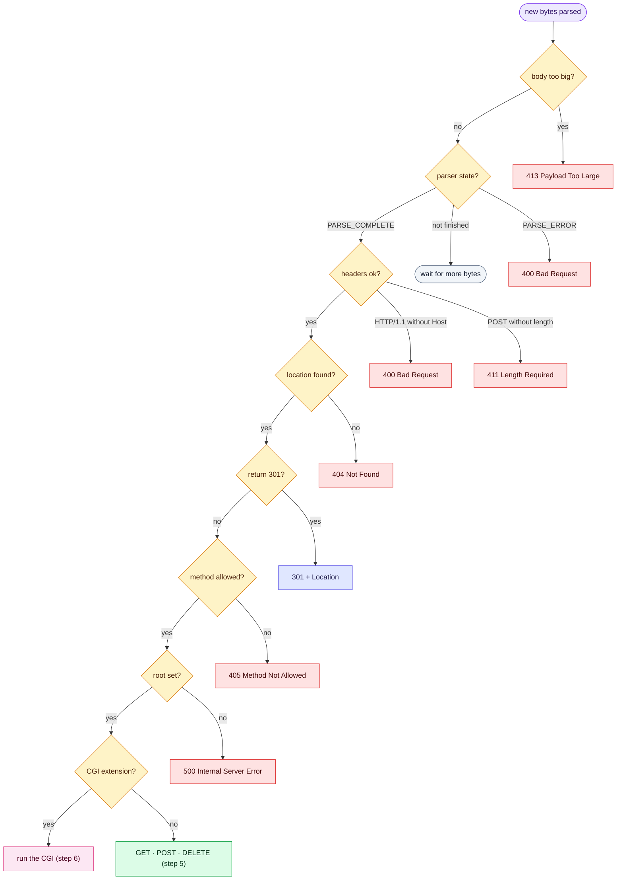

- **body too big**: `Content-Length` or the body is bigger than `client_max_body_size`.
  This runs as soon as the headers are read, so a client that announces 11 MB gets its `413` before it sends the body.
- **headers ok**: an HTTP/1.1 request needs a `Host` header. A `POST` needs `Content-Length` or `Transfer-Encoding`.
- **location found**: `findLocation()` takes the longest `location` prefix that matches the path.
- **CGI extension**: the path ends with the `cgi_pass` extension of the location.

Every error goes through `buildErrorResponse()`: it loads the `error_page` of the server, or builds a small HTML page.
Then `finalizeResponse()` sets the `Connection` header and turns the response into bytes in `send_buffer`.

### 5. GET, POST and DELETE

<sub>`src/http/methods/`</sub>

The file path is `root` (or the upload folder for `POST`) + the part of the URI after the location prefix.

#### GET

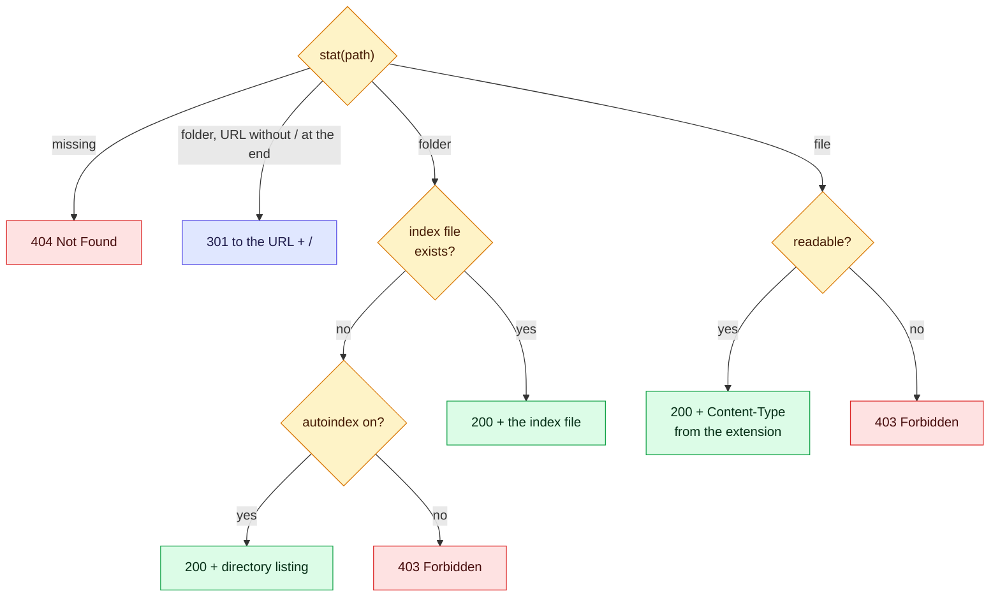

#### POST

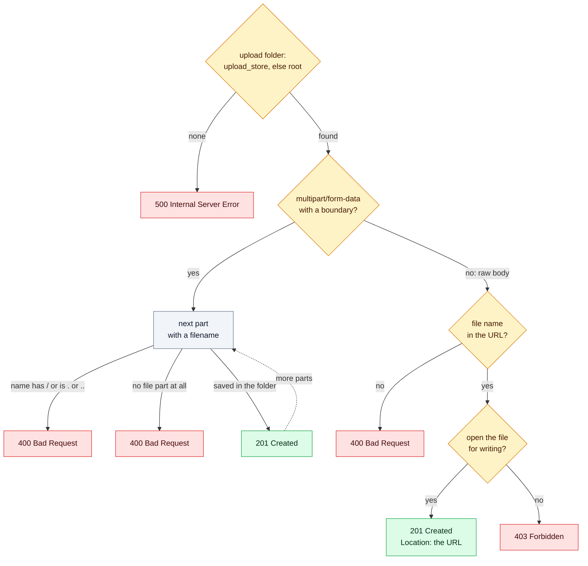

#### DELETE

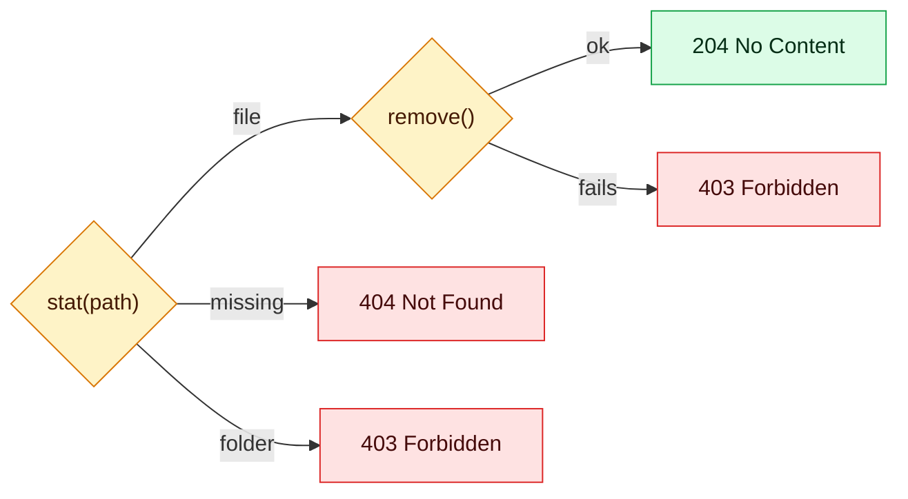

### 6. CGI

<sub>`src/CGI/needCGI.cpp` · `src/CGI/cgiBuildResponse.cpp` · `src/CGI/cgiIO.cpp` · `src/CGI/cgiFinishResponse.cpp`</sub>

The script runs in a child process, but the server never waits for it.
The two pipes go into the same `poll()` as the sockets, so other clients are served while the script works.

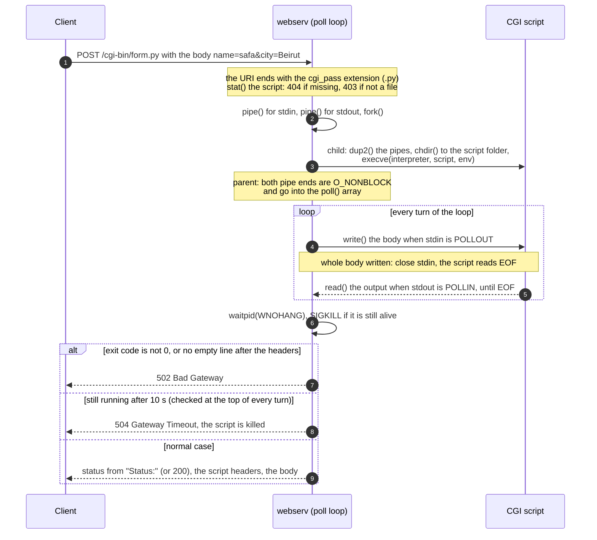

The environment of the script:

| Variable | Value |
|:--|:--|
| `REQUEST_METHOD` | `GET` or `POST` |
| `QUERY_STRING` | the part of the URL after `?` |
| `CONTENT_LENGTH` | the size of the body |
| `CONTENT_TYPE` | the `Content-Type` of the request, if any |
| `SCRIPT_NAME` | the URI, for example `/cgi-bin/form.py` |
| `SCRIPT_FILENAME` | the file name, for example `form.py` |
| `GATEWAY_INTERFACE` | `CGI/1.1` |
| `SERVER_PROTOCOL` | `HTTP/1.1` |
| `REDIRECT_STATUS` | `200` (`php-cgi` needs it) |
| `HTTP_*` | every other header, for example `HTTP_HOST`, `HTTP_USER_AGENT` |

- A chunked body is unchunked by the parser first, so the script always reads a plain body and then EOF.
- The script prints headers, an empty line (`\r\n\r\n` or `\n\n`), then the body.
- A `Status: 303 See Other` header becomes the status line. The other headers are copied to the response.
- The server counts the body and writes `Content-Length` itself, so the script does not have to.

### 7. Sending the answer, then keep-alive or close

<sub>`src/server/ClientIO.cpp` · `src/http/ResponseBuilder.cpp`</sub>

`send()` can accept only a part of the bytes. What is left stays in `send_buffer` for the next `POLLOUT`.

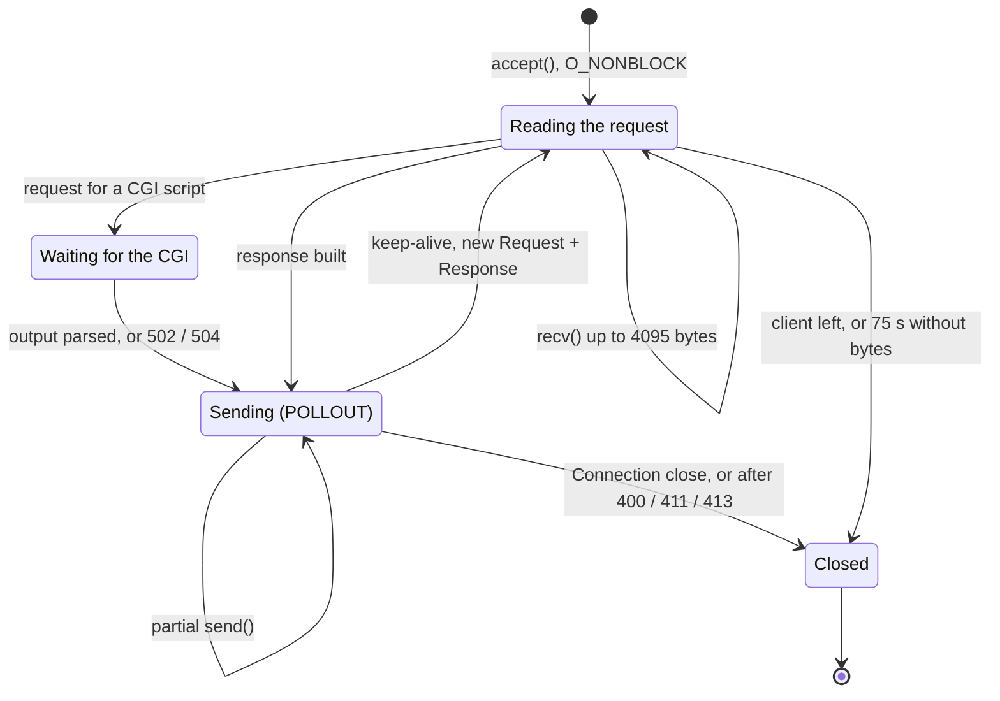

| Request | `Connection` header | After the response |
|:--|:--|:--|
| HTTP/1.1 | none, or `keep-alive` | the connection stays open |
| HTTP/1.1 | `close` | closed |
| HTTP/1.0 | `keep-alive` | the connection stays open |
| HTTP/1.0 | none | closed |
| any | the answer is `400`, `411` or `413` | closed: the rest of the bytes cannot be trusted |

### Every status code, and what triggers it

| Code | Name | When |
|:-:|:--|:--|
| 🟢 `200` | OK | a file, an index file, a directory listing, a CGI output |
| 🟢 `201` | Created | an upload is saved |
| 🟢 `204` | No Content | a file is deleted |
| 🔵 `301` | Moved Permanently | a `return 301`, or a folder URL without `/` at the end |
| 🟠 `400` | Bad Request | bad request line, header or chunk size, bad `%XX`, `..` above the root, HTTP/1.1 without `Host`, bad upload file name, multipart without a file, `POST` to a folder URL |
| 🟠 `403` | Forbidden | folder without index and `autoindex off`, file not readable, `DELETE` on a folder, upload folder not writable, CGI path that is not a file |
| 🟠 `404` | Not Found | no matching location, missing file, missing CGI script |
| 🟠 `405` | Method Not Allowed | the method is not in the `methods` of the location |
| 🟠 `411` | Length Required | `POST` without `Content-Length` and without `Transfer-Encoding` |
| 🟠 `413` | Payload Too Large | `Content-Length` or body bigger than `client_max_body_size` |
| 🔴 `500` | Internal Server Error | location without `root`, upload without a folder, `pipe()` or `fork()` failed |
| 🔴 `502` | Bad Gateway | the CGI exited with an error, or printed no header block |
| 🔴 `504` | Gateway Timeout | the CGI ran for more than 10 s |
| ⚪ any | from the script | a CGI script can choose any code with a `Status:` header |

### Timeouts

| What | Limit | Then | Where |
|:--|:--|:--|:--|
| idle client | 75 s without receiving a byte | the connection is closed | `checkClientTimeouts()` |
| CGI script | 10 s | `SIGKILL`, the client gets `504` | `checkCgiTimeouts()` |
| `poll()` | 5 s | the loop wakes up to check the two limits above | `runEventLoop()` |

A CGI timeout is seen at the next turn of the loop, so the `504` arrives between 10 and 16 seconds after the request.

## Evaluation cheat sheet

Start the server with `./webserv default.conf`, then copy and paste.
`-i` shows the status line and the headers. The comments show the answer we get.

### Testing tools

| Tool | What it is | Use it to |
|:--|:--|:--|
| `telnet localhost 8080` | opens a TCP connection, you type the request by hand | send one request slowly, line by line. Press <kbd>Enter</kbd> two times after the headers |
| `nc` (netcat) | sends exactly the bytes you give it | send bad requests that a browser cannot send (`printf '…' \| nc localhost 8080`) |
| `siege` | a load tester: many clients at the same time | check that the server stays available under load. Availability must be 100% |
| `./trace.sh` | runs the server under `strace` | see every `accept`, request, response and `close` live, with the open fds |

### GET

```bash
curl -i http://localhost:8080/                # 200, index.html
curl -i http://localhost:8080/files/          # 200, directory listing (autoindex on)
curl -i http://localhost:8080/files           # 301, Location: /files/
curl -i http://localhost:8080/nope.html       # 404, custom error page

# the same request with nc
printf 'GET / HTTP/1.1\r\nHost: localhost\r\nConnection: close\r\n\r\n' | nc localhost 8080
```

### POST: upload

```bash
# raw body, the file name comes from the URL: 201
curl -i -X POST --data-binary 'hello from raw post' http://localhost:8080/upload/raw.txt

# the same with nc: 201
printf 'POST /upload/raw_nc.txt HTTP/1.1\r\nHost: localhost\r\nContent-Length: 5\r\nConnection: close\r\n\r\nhello' | nc localhost 8080

# multipart/form-data, the file name comes from the form: 201
echo 'hello from multipart' > /tmp/multi.txt
echo 'second file' > /tmp/multi2.txt
curl -i -F "file=@/tmp/multi.txt" http://localhost:8080/upload
curl -i -F "file1=@/tmp/multi.txt" -F "file2=@/tmp/multi2.txt" http://localhost:8080/upload

# chunked body ("hello" + " world"), unchunked by the server: 201
printf 'POST /upload/chunked.txt HTTP/1.1\r\nHost: localhost\r\nTransfer-Encoding: chunked\r\nConnection: close\r\n\r\n5\r\nhello\r\n6\r\n world\r\n0\r\n\r\n' | nc localhost 8080
curl http://localhost:8080/upload/chunked.txt     # hello world

# see everything that was uploaded
curl http://localhost:8080/upload/
```

### DELETE

```bash
curl -i -X DELETE http://localhost:8080/upload/raw.txt    # 204
curl -i -X DELETE http://localhost:8080/upload/raw.txt    # 404, already deleted
curl -i -X DELETE http://localhost:8080/upload/           # 403, folders are never deleted
```

### CGI

```bash
curl -i http://localhost:8080/cgi-bin/hello.py               # 200
curl -i http://localhost:8080/cgi-bin/missing.py             # 404

# 200, shows the CGI environment
curl -i "http://localhost:8080/cgi-bin/env.py?name=webserv&x=1"

# 200, the script reads the body on stdin and prints the fields
curl -i -X POST -d 'name=safa&city=Beirut' http://localhost:8080/cgi-bin/form.py
```

In a browser: open <http://localhost:8080/cgi-bin/form.html>, fill the form, send it.

### Redirect

```bash
curl -i http://localhost:8080/old     # 301, Location: /
curl -iL http://localhost:8080/old    # follows the redirect: 301, then 200
```

### Errors

```bash
curl -i -X DELETE http://localhost:8080/       # 405, DELETE is not allowed on /
curl -i -X PUT http://localhost:8080/          # 405, PUT is never allowed

# 413, body too large (the limit is 10M)
head -c 11000000 /dev/zero | curl -i -X POST --data-binary @- http://localhost:8080/upload/big.bin

# 411, POST without Content-Length
printf 'POST /upload/x.txt HTTP/1.1\r\nHost: localhost\r\nConnection: close\r\n\r\n' | nc localhost 8080

# 400, bad requests: no Host header, unknown version, .. above the root
printf 'GET / HTTP/1.1\r\n\r\n' | nc localhost 8080
printf 'GET / HTTP/2.0\r\nHost: localhost\r\n\r\n' | nc localhost 8080
curl -i --path-as-is http://localhost:8080/../../etc/passwd
```

### Keep-alive

```bash
# two requests, one connection
curl -sv http://localhost:8080/ http://localhost:8080/files/ -o /dev/null -o /dev/null 2>&1 | grep -iE 're-?us|< connection'
# < Connection: keep-alive
# * Re-using existing connection! (#0) with host localhost
# < Connection: keep-alive

curl -si -0 http://localhost:8080/ | grep -i '^connection'    # HTTP/1.0: Connection: close
```

### Several servers

Start the server with `./webserv multipleServers.conf`.

```bash
curl -i http://127.0.0.1:8081/                   # 200, site of server 2
curl -i http://127.0.0.1:9000/                   # 200, app.html of server 3
curl -i http://127.0.0.1:9000/nothing-here       # 404, custom page of server 3

# 200, JSON from a CGI: {"method": "POST", "query": "x=1", "body": "hello=api"}
curl -i -X POST -d 'hello=api' "http://127.0.0.1:9000/api/info.py?x=1"

# 413, the body limit of server 2 is 1K
head -c 2000 /dev/zero | curl -i -X POST --data-binary @- http://127.0.0.1:8081/data/x.bin

# 200, PHP CGI
curl -i "http://localhost:8080/php/hello.php?name=webserv"

# 504 after 10 to 16 s: the script never ends, so the server kills it
curl -i http://localhost:8080/cgi-bin/infinite.py
```

### Stress test

```bash
siege -b -c 50 -t 30S http://localhost:8080/    # availability must be 100.00
```

On our machine, 10 seconds with 50 clients gave **490 966 transactions, 0 failed, 100.00 % availability**.

## Resources

### References

- [RFC 9110: HTTP Semantics](https://www.rfc-editor.org/rfc/rfc9110): methods, status codes, headers.
- [RFC 9112: HTTP/1.1](https://www.rfc-editor.org/rfc/rfc9112): message format, keep-alive, chunked encoding.
- [RFC 1945: HTTP/1.0](https://www.rfc-editor.org/rfc/rfc1945) and [RFC 2616: HTTP/1.1 (old version)](https://www.rfc-editor.org/rfc/rfc2616).
- [RFC 3875: CGI 1.1](https://www.rfc-editor.org/rfc/rfc3875): environment variables of CGI scripts.
- [nginx documentation](https://nginx.org/en/docs/): reference for the config file directives.
- [nginx source code on GitHub](https://github.com/nginx/nginx).
- [Beej's Guide to Network Programming](https://beej.us/guide/bgnet/): sockets, `poll()`.

### Our notes

- [Notion dashboard: WebServe](https://www.notion.so/3b67871ea4c18011912ac10dea47b7b8): our notes, the request flow, and the final notes for the evaluation.

### How we used AI

- **Understanding the concepts:** we used AI to make visualizations, dashboards and interactive websites
  that explain the concepts (the `poll()` loop, the request flow, CGI).
- **HTML and CSS:** AI wrote the HTML and CSS of the test websites in `www/` and of the error pages in `errors/`,
  so we did not lose time on parts that are not the goal of the project.
- **This README:** AI helped us draw the images in `assets/` and the diagrams, from our source code.

<p align="center">
  
</p>
